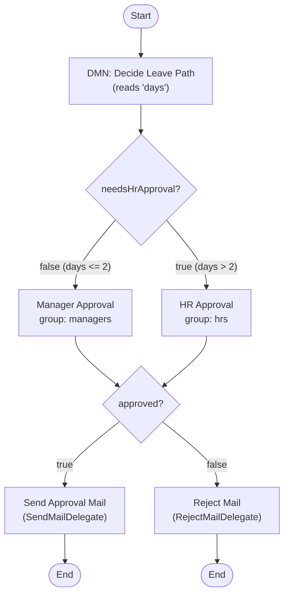

# Flowable Leave Approval

A leave approval workflow built with **Spring Boot** and the **Flowable** workflow engine.
A **BPMN** process drives the steps, and a **DMN** decision table decides whether a request
needs **HR** approval or only a **Manager**, based on the number of leave days.

> A learning project exploring Flowable: user tasks, gateways, service tasks, Java delegates and DMN decision tables.

## Tech stack

| Part | Technology |
|---|---|
| Language | Java 21+ |
| Framework | Spring Boot 4.2.0 (Spring MVC) |
| Workflow engine | Flowable 8.0.0 (BPMN + DMN) |
| Database | H2 (in-memory, created automatically) |
| Build tool | Maven (wrapper included) |

## How it works



1. An employee applies for leave with a number of `days`.
2. The **DMN decision table** (`leaveApprovalRules`) sets `needsHrApproval`:

   | days | needsHrApproval |
      |---|---|
   | `<= 2` | `false` |
   | `> 2` | `true` |

3. An exclusive gateway routes the request to **Manager Approval** or **HR Approval**.
4. A person from that group claims the task and completes it with `approved=true` or `false`.
5. A Java delegate "sends" the approval or rejection mail (printed to the console).

To change the business rule (for example, HR needed above 3 days), edit only the DMN file. No Java change is needed.

## Project structure

```
src/main
├── java/com/example/demo_flowable
│   ├── DemoFlowableApplication.java      # Spring Boot entry point
│   ├── controller/LeaveController.java   # REST endpoints
│   ├── service/LeaveService.java         # Talks to Flowable (RuntimeService, TaskService)
│   └── delegate/
│       ├── SendMailDelegate.java         # Runs when a request is approved
│       └── RejectMailDelegate.java       # Runs when a request is rejected
└── resources
    ├── processes/leave-request.bpmn20.xml   # BPMN process definition
    └── dmn/leave-approval.dmn               # DMN decision table
```

## Getting started

### Prerequisites

- JDK 21 or newer (`java -version`)

### Run

```bash
# Linux / macOS
./mvnw spring-boot:run

# Windows
.\mvnw.cmd spring-boot:run
```

The app starts on **http://localhost:8080**. Flowable creates its tables in an in-memory H2 database
and auto-deploys the BPMN and DMN files at startup. Data is lost when the app stops.

## API

| Action | Method | Endpoint |
|---|---|---|
| Apply for leave | `POST` | `/leave/apply?employee={name}&days={n}` |
| List pending tasks | `GET` | `/leave/tasks` |
| Claim a task | `POST` | `/leave/tasks/{taskId}/claim?user={user}` |
| Complete a task | `POST` | `/leave/tasks/{taskId}/complete?approved={true\|false}` |

- `apply` returns the **process instance ID** (one leave request).
- `tasks` returns the **task ID** (one pending step). Use this ID for `claim` and `complete`.
- Once a task is claimed it may disappear from `/leave/tasks`, because that list shows unassigned tasks. The task still exists and can be completed.

## Try it

On Windows PowerShell use `curl.exe` (plain `curl` is an alias for another command). POST requests cannot be sent from a browser address bar, so use curl or Postman.

**Short leave (1 day) goes to the Manager**

```bash
curl -X POST "http://localhost:8080/leave/apply?employee=Adi&days=1"
curl "http://localhost:8080/leave/tasks"
# -> [{"id":"<TASK_ID>","name":"Manager Approval"}]
curl -X POST "http://localhost:8080/leave/tasks/<TASK_ID>/claim?user=manager1"
curl -X POST "http://localhost:8080/leave/tasks/<TASK_ID>/complete?approved=true"
```

**Long leave (5 days) goes to HR**

```bash
curl -X POST "http://localhost:8080/leave/apply?employee=Rafi&days=5"
curl "http://localhost:8080/leave/tasks"
# -> [{"id":"<TASK_ID>","name":"HR Approval"}]
curl -X POST "http://localhost:8080/leave/tasks/<TASK_ID>/claim?user=hr1"
curl -X POST "http://localhost:8080/leave/tasks/<TASK_ID>/complete?approved=false"
```

### How to tell it is working

| What you see | What it means |
|---|---|
| Task named **Manager Approval** for `days=1` | DMN routed to the Manager |
| Task named **HR Approval** for `days=5` | DMN routed to HR |
| Console prints an approval line after `approved=true` | Gateway chose the approval path and the Java delegate ran |
| Console prints a rejection line after `approved=false` | Gateway chose the rejection path |
| Completing the same task twice gives an error | The process moved on and finished |

## Notes and limitations

- Mail sending is simulated with `System.out.println`.
- There is no authentication. Any user name can claim any task.
- Group membership (`managers`, `hrs`) is declared in the BPMN but not enforced against a user directory.
- There is no input validation, so a wrong task ID returns a server error.
- H2 is in-memory only. Use a persistent database for anything real.

## What this project demonstrates

- Deploying BPMN and DMN files automatically with Spring Boot
- User tasks with candidate groups, claim and complete
- Exclusive gateways with default flows
- A DMN service task that writes its result into process variables
- Java delegates (`JavaDelegate`) called from a service task
- Driving the engine through `RuntimeService` and `TaskService`

